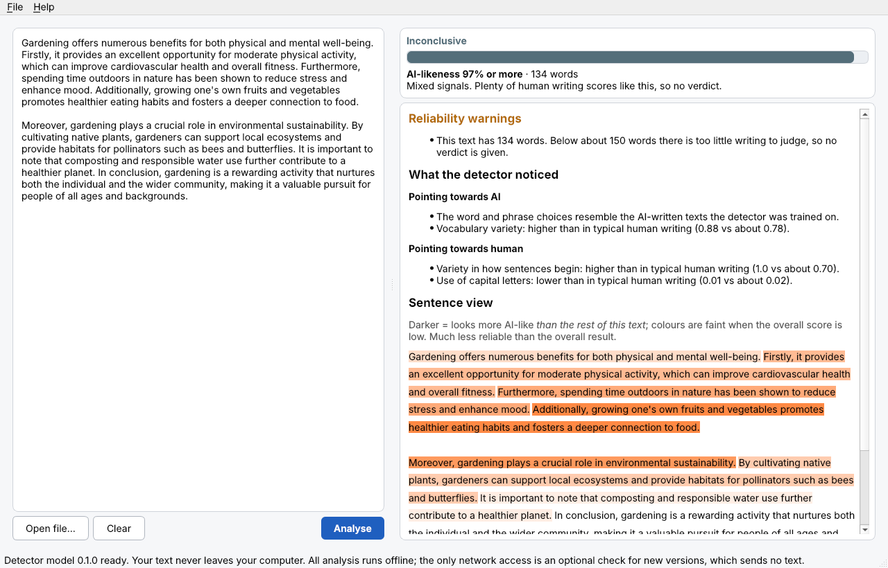
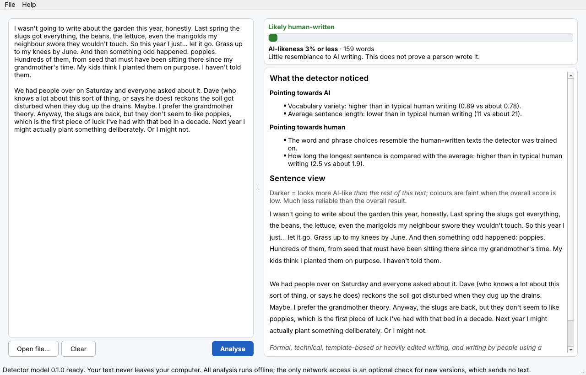

# AI Text Detector

A free desktop app for Windows and Mac that estimates whether a piece of
writing was produced by an AI chatbot. Paste text or drop in a `.txt`, `.docx`
or `.pdf` file, and it gives you:

- a verdict (*Likely AI-generated*, *Inconclusive*, or *Likely human-written*),
- an AI-likeness score with a plausible range,
- a sentence view showing which parts look most AI-like,
- a plain-language list of what it noticed,
- clear warnings when the result should not be trusted.

**It runs entirely on your computer.** Your text is never uploaded anywhere.



*An AI-written sample: it scores 97% AI-likeness, but the app still says
"Inconclusive", because it only gives an AI verdict when the evidence is very
strong. This caution is deliberate (see accuracy below).*

> **Please read [Limitations](#limitations) before relying on a result.**
> AI detection is guesswork with statistics. Never use this tool as the only
> reason to accuse someone of using AI.

## Install

Download the file for your computer from the
[Releases page](https://github.com/ianstanojevic/iansta/releases) (look for
the newest "aidetect" release).

### Windows

1. Download `AI-Text-Detector-…-Windows-Setup.exe` and open it.
2. Windows may show **"Windows protected your PC"**. This appears because the
   app is not signed with a paid certificate. Click **More info**, then
   **Run anyway**.
3. Follow the installer. No administrator password is needed. The app appears
   in the Start menu as **AI Text Detector**.

### Mac

1. Download the `.dmg` for your Mac: **AppleSilicon** for Macs from 2020 on
   (M1, M2, M3, M4 ...), **Intel** for older ones. Not sure? Apple menu → About
   This Mac: "Chip: Apple ..." means Apple Silicon.
2. Open the `.dmg` and drag **AI Text Detector** onto **Applications**.
3. The first time you open it, macOS will say it "cannot be opened" or "cannot
   verify the developer", because the app is not signed with a paid Apple
   certificate. Open **System Settings → Privacy & Security**, scroll down, and
   click **Open Anyway** next to the message about AI Text Detector. You only
   need to do this once.

## Use

1. Paste the text into the left box, or drag a file onto it (or use
   **Open file…**).
2. Click **Analyse**. It takes about a second.
3. Read the verdict, the warnings and the reasons on the right.

Tips:

- Use at least **150 words** of continuous writing. Shorter texts get no
  verdict, because there is too little to go on.
- Analyse prose only: remove reference lists, tables, code and long quotations.
- The **sentence view** is relative: it shows which parts look *more* AI-like
  than the rest of the same text, not which sentences are AI-written.



## How accurate is it?

Measured on texts of 150+ words (full report: [reports/EVALUATION.md](reports/EVALUATION.md)):

| | Human texts wrongly flagged as AI | AI texts caught |
|---|---|---|
| Texts similar to the training data | 0.5% | 78% |
| Texts from other datasets the detector never saw | 0.4% | 26% |
| Essays by non-native English writers (four test sets) | 0% | n/a |
| Human answers to chatbot-style questions (worst case found) | 7.3% | 27% |

The detector is tuned to **rarely accuse a human**, at the cost of missing many
AI texts. In practice: a *Likely AI-generated* verdict is fairly strong
evidence; *Inconclusive* or *Likely human-written* does **not** mean a human
wrote it, especially if the text was edited or reworded after the AI wrote it.

## Limitations

- **It is an estimate, never proof.** Do not use it as the sole basis for
  accusing anyone; at most it is a reason for a conversation.
- **It misses a lot of AI text**, especially text that a person has edited,
  paraphrased, or run through a "humanizer", and text from recent AI models.
  Its training data comes from models released up to 2024.
- **Some human writing looks more AI-like**: formal, technical or
  template-based writing, and very polished text. Writing by people using
  English as a second language is a known weak spot of AI detectors in
  general; this one was specifically tested on it (see the report), but no test
  covers everyone.
- **English prose only.** Code, lists, poems, other languages and heavy
  quotation give unreliable results (the app warns you).
- **Short texts** (under about 150 words) get no verdict.

## Command line

For people comfortable with a terminal (requires Python 3.11 or newer):

```bash
pip install "git+https://github.com/ianstanojevic/iansta.git#subdirectory=aidetect"
aidetect essay.docx          # verdict, score, warnings, reasons
aidetect essay.pdf --json    # machine-readable
aidetect --limitations
```

## Privacy

All analysis happens on your computer, with no account and no telemetry. The only
network request the app makes is an optional check for a newer version (Help
menu), which sends no text; you can switch it off there.

## For developers

See [DEVELOPING.md](DEVELOPING.md) for the data pipeline, training,
evaluation and building the installers. Data sources and licences are in
[docs/DATA_SOURCES.md](docs/DATA_SOURCES.md). The trained model is for
**non-commercial use only**, because some training data is licensed that way.
