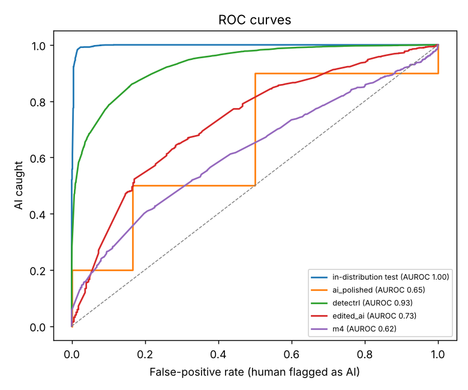
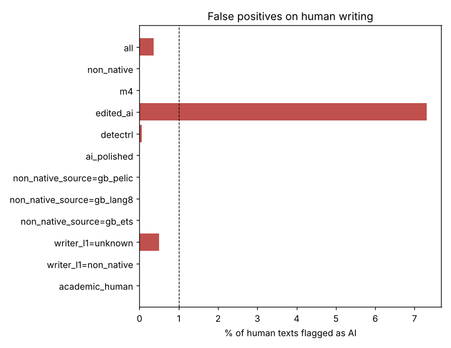
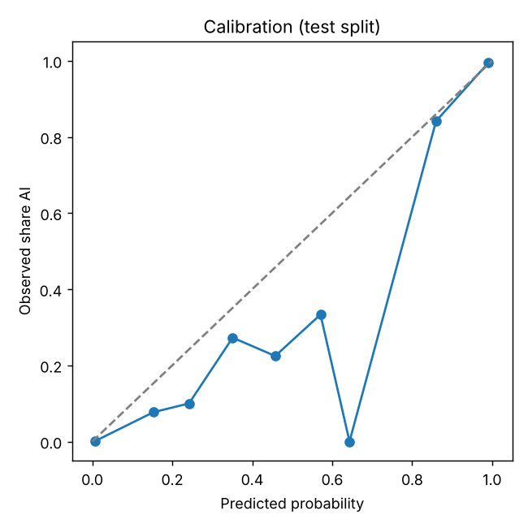

# Evaluation report

Model 0.1.0, trained on: Ghostbuster (2023 ChatGPT and Claude essays, stories, news) and ELLIPSE (English-learner essays). Decision threshold 0.99 (chosen for at most 1% false positives on held-out human text).

"False positives" are human texts the detector would flag as AI; this is the number that matters most. "AI caught" is the share of AI texts flagged. Out-of-distribution (OOD) sets come from different datasets than training and are the honest measure of real-world behaviour. All tables except the length table cover texts of 150+ words, the only ones the app gives a verdict on.

## In-distribution test split

| slice | n | AUROC | false positives on human text (95% CI) | AI caught | precision | F1 |
|---|---|---|---|---|---|---|
| all | 3222 | 0.997 | 0.5% (0.2%–1.1%) | 77.7% | 99.7% | 87.3% |
| domain = creative_writing | 677 | 1.000 | 0.0% (0.0%–3.9%) | 79.4% | 100.0% | 88.5% |
| domain = instruction_closed_qa | 2 | – | – | 0.0% | – | – |
| domain = instruction_generation | 75 | 0.974 | 0.0% (0.0%–15.5%) | 33.3% | 100.0% | 50.0% |
| domain = instruction_open_qa | 27 | 0.682 | 20.0% (3.6%–62.4%) | 13.6% | 75.0% | 23.1% |
| domain = instruction_rewrite | 85 | 0.655 | 17.4% (7.0%–37.1%) | 21.0% | 76.5% | 32.9% |
| domain = instruction_summarize | 13 | 0.833 | 0.0% (0.0%–79.3%) | 25.0% | 100.0% | 40.0% |
| domain = news | 788 | 1.000 | 0.0% (0.0%–2.9%) | 87.1% | 100.0% | 93.1% |
| domain = student_essay | 948 | 0.999 | 0.0% (0.0%–2.4%) | 78.8% | 100.0% | 88.2% |
| domain = student_essay_k12 | 607 | – | 0.0% (0.0%–0.6%) | – | – | – |
| generator_family = anthropic-claude | 392 | – | – | 67.6% | – | – |
| generator_family = google-gemma | 24 | – | – | 58.3% | – | – |
| generator_family = human | 1036 | – | 0.5% (0.2%–1.1%) | – | – | – |
| generator_family = meta-llama | 77 | – | – | 11.7% | – | – |
| generator_family = mistral | 51 | – | – | 27.5% | – | – |
| generator_family = openai-gpt3.5 | 1642 | – | – | 85.0% | – | – |
| len_band = 150-300 | 386 | 0.971 | 1.2% (0.4%–3.6%) | 32.4% | 94.0% | 48.2% |
| len_band = 300-600 | 2135 | 1.000 | 0.0% (0.0%–0.6%) | 80.9% | 100.0% | 89.5% |
| len_band = 600+ | 701 | 0.995 | 1.0% (0.3%–3.5%) | 80.7% | 99.5% | 89.1% |

## Out-of-distribution sets

| slice | n | AUROC | false positives on human text (95% CI) | AI caught | precision | F1 |
|---|---|---|---|---|---|---|
| academic_human | 987 | – | 0.0% (0.0%–0.4%) | – | – | – |
| ai_polished | 16 | 0.650 | 0.0% (0.0%–39.0%) | 0.0% | 0.0% | 0.0% |
| detectrl | 9506 | 0.931 | 0.1% (0.0%–0.2%) | 28.3% | 99.9% | 44.1% |
| edited_ai | 1281 | 0.730 | 7.3% (5.0%–10.7%) | 27.0% | 91.5% | 41.7% |
| humanizer | 98 | – | – | 66.3% | – | – |
| m4 | 1791 | 0.622 | 0.0% (0.0%–0.4%) | 5.6% | 100.0% | 10.7% |
| non_native | 1315 | – | 0.0% (0.0%–0.3%) | – | – | – |
| **all OOD** | 14994 | 0.918 | 0.4% (0.2%–0.5%) | 26.3% | 98.8% | 41.5% |

### Human writing by native / non-native writers

| slice | n | AUROC | false positives on human text (95% CI) | AI caught | precision | F1 |
|---|---|---|---|---|---|---|
| writer = non_native | 1922 | – | 0.0% (0.0%–0.2%) | – | – | – |
| writer = unknown | 6253 | – | 0.5% (0.3%–0.7%) | – | – | – |
| non-native: gb_ets | 967 | – | 0.0% (0.0%–0.4%) | – | – | – |
| non-native: gb_lang8 | 170 | – | 0.0% (0.0%–2.2%) | – | – | – |
| non-native: gb_pelic | 178 | – | 0.0% (0.0%–2.1%) | – | – | – |

### AI text: unedited vs edited / attacked (all sets)

| slice | n | AUROC | false positives on human text (95% CI) | AI caught | precision | F1 |
|---|---|---|---|---|---|---|
| edit = back_translation | 699 | – | – | 6.6% | – | – |
| edit = char_attack | 673 | – | – | 28.4% | – | – |
| edit = char_word_attack | 703 | – | – | 31.9% | – | – |
| edit = dipper_paraphrase | 550 | – | – | 22.2% | – | – |
| edit = expert_edit | 501 | – | – | 20.2% | – | – |
| edit = humanizer | 98 | – | – | 66.3% | – | – |
| edit = llm_polish | 633 | – | – | 49.6% | – | – |
| edit = none | 4152 | – | – | 51.4% | – | – |
| edit = prompt_few_shot | 648 | – | – | 26.4% | – | – |
| edit = prompt_sico_evasion | 694 | – | – | 24.6% | – | – |
| edit = word_attack | 690 | – | – | 32.5% | – | – |

### By source model family (OOD AI text)

| slice | n | AUROC | false positives on human text (95% CI) | AI caught | precision | F1 |
|---|---|---|---|---|---|---|
| anthropic-claude | 1514 | – | – | 5.4% | – | – |
| bigscience-bloom | 164 | – | – | 0.6% | – | – |
| cohere | 122 | – | – | 2.5% | – | – |
| databricks-dolly | 179 | – | – | 0.0% | – | – |
| google-gemma | 157 | – | – | 54.8% | – | – |
| google-palm | 1202 | – | – | 35.9% | – | – |
| meta-llama | 1920 | – | – | 19.2% | – | – |
| mistral | 280 | – | – | 18.6% | – | – |
| openai-gpt3 | 137 | – | – | 0.7% | – | – |
| openai-gpt3.5 | 2164 | – | – | 48.2% | – | – |

### By length (test + OOD)

| slice | n | AUROC | false positives on human text (95% CI) | AI caught | precision | F1 |
|---|---|---|---|---|---|---|
| <150 words | 9399 | 0.846 | 0.7% (0.5%–1.1%) | 20.3% | 98.5% | 33.7% |
| 150-300 words | 9983 | 0.899 | 0.4% (0.3%–0.7%) | 25.1% | 98.7% | 40.0% |
| 300-600 words | 6238 | 0.968 | 0.4% (0.2%–0.7%) | 50.4% | 99.5% | 66.9% |
| 600+ words | 1995 | 0.987 | 0.2% (0.1%–0.6%) | 70.3% | 99.3% | 82.4% |

### How often human writing gets each verdict (OOD human texts, 150+ words)

| set | Likely AI-generated | Inconclusive | Likely human-written |
|---|---|---|---|
| academic_human | 0.0% | 3.3% | 96.7% |
| ai_polished | 0.0% | 50.0% | 50.0% |
| detectrl | 0.1% | 34.2% | 65.8% |
| edited_ai | 7.3% | 73.5% | 19.2% |
| m4 | 0.0% | 63.8% | 36.2% |
| non_native | 0.0% | 4.5% | 95.5% |
| all | 0.4% | 30.4% | 69.3% |

### Human text polished or rewritten by AI ("mixed", not scored as right or wrong)

| edit | n | share flagged as AI |
|---|---|---|
| ai_polish | 795 | 6.4% |
| ai_polish_1 | 39 | 10.3% |
| ai_polish_10 | 23 | 8.7% |
| ai_polish_20 | 15 | 6.7% |
| ai_polish_35 | 26 | 15.4% |
| ai_polish_5 | 30 | 3.3% |
| ai_polish_50 | 20 | 15.0% |
| ai_polish_75 | 18 | 0.0% |
| ai_polish_extreme_minor | 52 | 1.9% |
| ai_polish_major | 244 | 34.0% |
| ai_polish_minor | 33 | 3.0% |
| ai_polish_slight_major | 79 | 15.2% |
| back_translation | 781 | 0.0% |
| dipper_paraphrase | 576 | 0.0% |

## Charts

## How to read this

- Rates are shown with 95% Wilson confidence intervals where they matter most.
- The app never shows a verdict for texts under 150 words; the length table shows why.
- These numbers describe the datasets above. Writing that differs from all of them (other genres, newer AI models, heavy editing) can behave differently.
